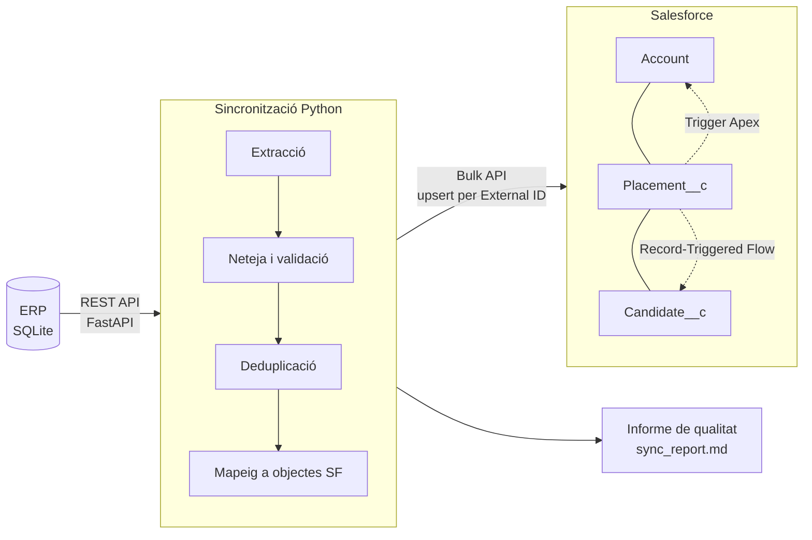
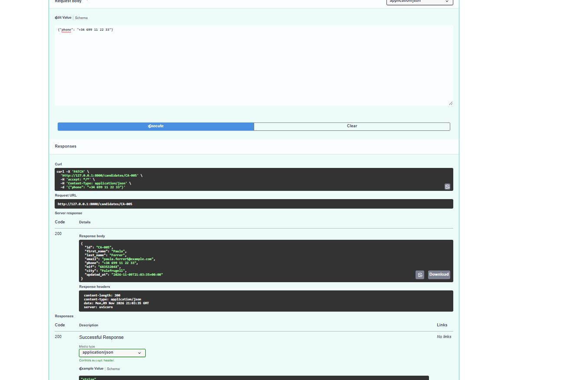
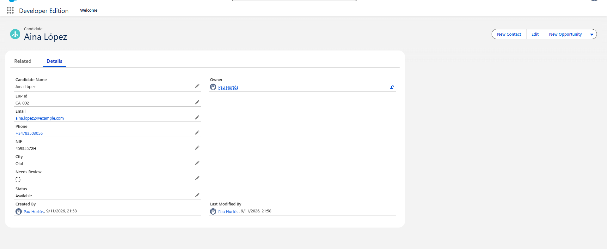

# HR Sync: integració ERP → Salesforce

Integració entre l'ERP d'una empresa de treball temporal i el seu CRM a Salesforce. Les dades
de l'ERP arriben brutes (duplicats, formats inconsistents, errors de picatge). El projecte les
neteja i les valida, les sincronitza de manera incremental i idempotent, i a Salesforce
s'executen automatitzacions sobre les dades que hi entren.

> **Context:** projecte personal per practicar la integració de sistemes (ERP ↔ CRM) amb el
> flux d'una empresa de treball temporal. L'ERP és simulat i totes les dades són sintètiques,
> generades amb errors realistes a propòsit.

**Tecnologies:** Python 3.10+ · FastAPI · SQLite · Salesforce (Bulk API, Apex, Flows) ·
simple-salesforce · pytest



## Què fa

| Peça | Detall |
|---|---|
| **ERP simulat** (`erp/`) | API REST amb FastAPI sobre SQLite: clients, candidats i contractes. Les dades de prova es generen amb errors realistes a propòsit |
| **Neteja** (`sync/cleaning.py`) | Telèfons a E.164, validació de NIF/NIE i CIF amb dígit de control, emails, noms, dates en diversos formats, imports amb coma decimal, estats en català/castellà/anglès |
| **Deduplicació** | Detecta duplicats per CIF (clients) i per NIF, email o nom + telèfon (candidats). Es fusionen conservant l'id ERP més antic i els valors més recents. Els contractes que apuntaven al duplicat es redirigeixen al registre mestre |
| **Sincronització** (`sync/run_sync.py`) | Upsert amb la Bulk API per External ID (`ERP_Id__c`), en ordre de dependències. És incremental: només envia el que ha canviat des de l'última execució correcta |
| **Salesforce** (`salesforce/`) | Objectes i camps personalitzats amb External IDs. Trigger d'Apex *bulkified* amb test que manté el recompte de contractes actius per client, i guia per al Flow que actualitza l'estat del candidat |
| **Informe** | Cada execució genera un informe amb volums i totes les incidències de qualitat. Exemple: [`docs/sample_report.md`](docs/sample_report.md) |

Resultat amb les dades de prova: **15 → 12 clients, 68 → 60 candidats, 80 → 75 contractes**,
amb 33 incidències detectades i documentades.

## Resultats amb Salesforce real

Provat contra un org de Salesforce Developer Edition.

**1. Primera càrrega:** 147 registres creats, 0 errors

```
INFO ERP: 15 clients, 68 candidats, 80 contractes
INFO Després de netejar: 12 clients, 60 candidats, 75 contractes (33 incidències)
INFO Account: 12 enviats, 12 creats, 0 actualitzats, 0 errors
INFO Candidate__c: 60 enviats, 60 creats, 0 actualitzats, 0 errors
INFO Placement__c: 75 enviats, 75 creats, 0 actualitzats, 0 errors
```

**2. Reexecució (idempotència):** no es crea cap duplicat

```
INFO Account: 12 enviats, 0 creats, 12 actualitzats, 0 errors
INFO Candidate__c: 60 enviats, 0 creats, 60 actualitzats, 0 errors
INFO Placement__c: 75 enviats, 0 creats, 75 actualitzats, 0 errors
```

**3. Sincronització incremental:** es canvia un telèfon a l'ERP i només s'envia aquell registre

```
INFO Account: 0 enviats, 0 creats, 0 actualitzats, 0 errors
INFO Candidate__c: 1 enviats, 0 creats, 1 actualitzats, 0 errors
INFO Placement__c: 0 enviats, 0 creats, 0 actualitzats, 0 errors
```

| Canvi a l'ERP via API | Candidat a Salesforce, amb les dades normalitzades |
|---|---|
|  |  |

## Executar-ho en local (2 minuts, sense Salesforce)

Requereix **Python 3.10 o superior**.

```bash
python -m venv .venv && source .venv/bin/activate
pip install -r requirements.txt

python -m erp.seed                     # crea l'ERP amb dades brutes
uvicorn erp.api:app --reload           # API a http://127.0.0.1:8000/docs

# en una altra terminal
python -m sync.run_sync --full --dry-run   # escriu el que enviaria a output/*.json
pytest -q                                  # 25 tests
```

Per provar la sincronització incremental:

```bash
curl -X PATCH localhost:8000/candidates/CA-005 \
     -H 'content-type: application/json' -d '{"phone": "+34 699 11 22 33"}'
python -m sync.run_sync --dry-run          # només envia CA-005
```

## Connectar-ho a Salesforce

Segueix [`docs/SALESFORCE_SETUP.md`](docs/SALESFORCE_SETUP.md): org gratuït, objectes i camps,
permisos, Flow, desplegament de l'Apex i credencials. Després executa:

```bash
python -m sync.run_sync --full
```

> **Nota sobre l'autenticació:** Salesforce està retirant el login per usuari, contrasenya i
> token (SOAP API `login()`, retirada prevista per a Summer '27), i en els orgs nous ve
> desactivat per defecte. Per a aquesta demo s'ha activat de manera explícita. En un entorn
> real caldria fer servir OAuth amb una External Client App (flux *Client Credentials*), que el
> codi ja suporta amb `SF_CONSUMER_KEY`, `SF_CONSUMER_SECRET` i `SF_DOMAIN`.

## Decisions de disseny

- **Upsert per External ID.** L'script no necessita conèixer els Id interns de Salesforce. Per
  això es pot reexecutar sense crear duplicats (és idempotent), i les relacions es resolen
  directament per l'id de l'ERP (`Account__r.ERP_Id__c`).
- **Es llegeix tot, però s'envia només el que ha canviat.** La deduplicació i la validació de
  referències necessiten el context complet de l'ERP. En canvi, l'escriptura a Salesforce és el
  que consumeix límits d'API, així que es limita als canvis.
- **La marca de temps només avança si no hi ha errors.** Si una execució falla, la següent torna
  a provar els mateixos registres. Es compara amb `>=` i no amb `>`: un canvi al mateix segon es
  pot reenviar sense problema, perquè l'upsert és idempotent.
- **El sistema mestre de cada camp és clar.** L'ERP és el mestre de les dades del candidat, però
  `Status__c` el gestiona Salesforce (el Flow) i la sincronització no el sobreescriu.
- **No es perd cap dada en silenci.** Tot el que es descarta, es fusiona o es rebutja surt a
  l'informe. Els registres dubtosos es marquen amb `Needs_Review__c` perquè els revisi una
  persona.
- **Tota la lògica de neteja són funcions pures**, provades sense xarxa ni base de dades.

## Limitacions i properes passes

- Migrar l'autenticació a OAuth (External Client App) abans de la retirada del SOAP `login()`.
- El Flow posa el candidat com a `Available` en tancar un contracte, encara que en tingui un
  altre d'actiu. S'hauria de comprovar abans de canviar l'estat.
- Les eliminacions a l'ERP no es propaguen. Caldria fer *soft delete* a l'ERP o una
  reconciliació periòdica.
- El sentit Salesforce → ERP (per exemple, l'estat del candidat) quedaria per a una segona
  fase, amb Change Data Capture o Platform Events.
- Execució programada (cron o GitHub Actions) i alertes quan hi hagi errors.
- La deduplicació per nom + telèfon és exacta. Es podria fer difusa (distància de Levenshtein)
  amb revisió manual.

## Estructura

```
erp/            API i base de dades de l'ERP simulat, i generador de dades
sync/           neteja, mapeig a Salesforce i execució de la sincronització
salesforce/     metadades Apex (projecte SFDX)
tests/          tests de pytest
docs/           guia de configuració de Salesforce i informe d'exemple
```
